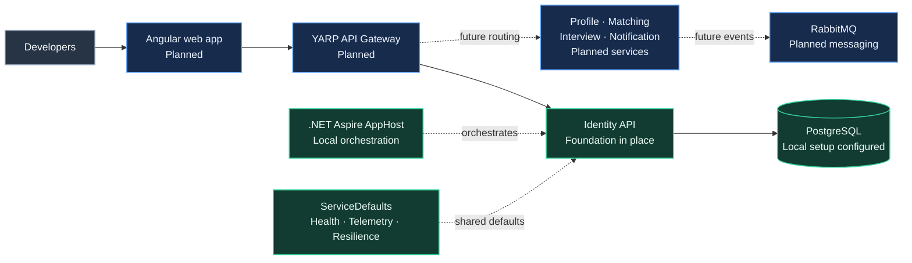

  

  <h3>Thoughtful software. Practical products. Reliable foundations.</h3>

  

    <a href="https://github.com/OrbitForgeLabs">Repositories</a>
    &nbsp;·&nbsp;
    <a href="#featured-product">Featured product</a>
    &nbsp;·&nbsp;
    <a href="#engineering-approach">Engineering approach</a>
  

---

## Who we are

**OrbitForgeLabs** is an independent software development organization focused on building useful digital products through deliberate engineering, clear architecture and incremental delivery.

We value practical solutions over unnecessary complexity, and strong foundations over rushing to features.

## Featured product

  <h3>PrepCircle</h3>
  
<strong>Peer-to-peer interview practice for developers.</strong>

  
Find practice partners, arrange reciprocal interview sessions, switch between interviewer and candidate roles, and exchange structured feedback.

  

    
    
  

PrepCircle is being built in stages. Its source repository is private while the product is under development; this page shares the product direction and a high-level view of its engineering foundation.

## Architecture at a glance

The diagram distinguishes the foundation already present in the repository from components selected for later phases.

Green indicates the current foundation; blue indicates planned components. The diagram is an architectural direction, not a claim that every service is already implemented.

## Project foundation

The current repository baseline includes:

| Area | Current state |
|---|---|
| .NET solution | .NET 10 solution and shared build configuration |
| Local orchestration | .NET Aspire AppHost and ServiceDefaults |
| Identity | Identity API skeleton registered with Aspire |
| Database | Dedicated PostgreSQL 17 local Compose setup |
| Data access | EF Core 10 / Npgsql connection configured for Identity |
| Health | PostgreSQL connectivity health check |

### Planned in later phases

- Identity authentication using ASP.NET Core Identity and OpenIddict, with EF Core migrations.
- YARP as the public API gateway.
- Profile, Matching, Interview and Notification services, each owning its database.
- RabbitMQ for asynchronous integration events when a consuming service needs them.
- Angular frontend, initially running separately from Aspire.

No delivery dates are published; implementation will proceed incrementally as each foundation is validated.

## Technology direction

**Backend & API**

**Frontend**

**Data & messaging**

**Platform & observability**

Badges communicate the selected project stack. Refer to the foundation and roadmap sections above for implementation status.

## Engineering approach

| Principle | How it guides our work |
|---|---|
| Incremental delivery | Establish and validate foundations before expanding scope. |
| Clear boundaries | Keep service responsibilities and data ownership explicit. |
| Reliability | Design for health checks, observability, resilience and failure handling. |
| Security by design | Keep secrets out of source control and use established identity standards. |
| Cost awareness | Prefer local development and zero-cost, open-source infrastructure. |
| Maintainability | Favor readable code, documented decisions and useful abstractions. |

## Explore

- [Browse OrbitForgeLabs repositories](https://github.com/OrbitForgeLabs)
- [Read about GitHub organization profiles](https://docs.github.com/en/organizations/collaborating-with-groups-in-organizations/customizing-your-organizations-profile)

---

**ORBITFORGELABS**

*Engineering with intention. Building with purpose.*

