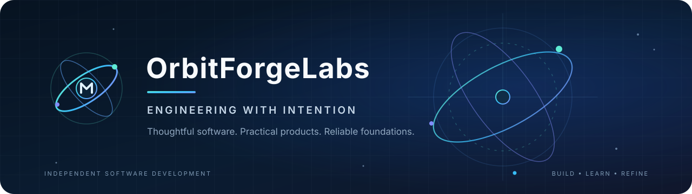
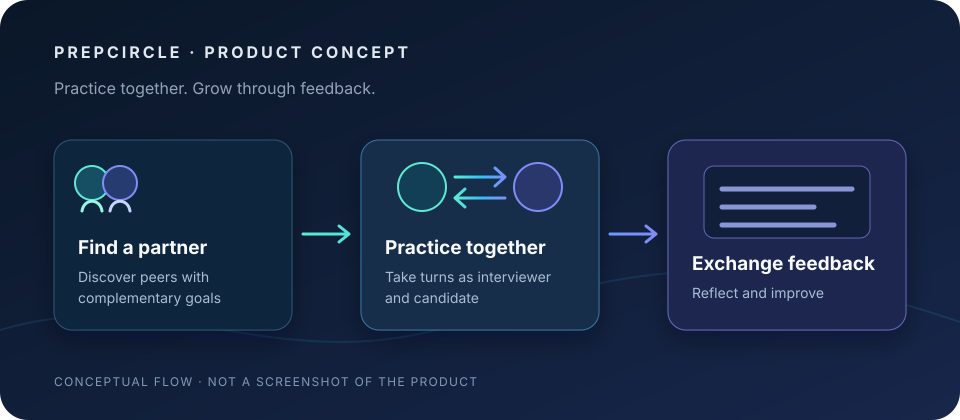

  <a href="#featured-product">Featured product</a>
  &nbsp;·&nbsp;
  <a href="#engineering">Engineering</a>
  &nbsp;·&nbsp;
  <a href="architecture.md">Architecture overview</a>
  &nbsp;·&nbsp;
  <a href="https://github.com/OrbitForgeLabs">Repositories</a>

---

## Building software with intention

**OrbitForgeLabs** is an independent software development organization focused on useful digital products, clear architecture and deliberate engineering.

We favor practical solutions, reliable foundations and steady progress over unnecessary complexity.

## Featured product

<h3>PrepCircle</h3>

**Peer-to-peer interview practice for developers.**

Find practice partners, arrange reciprocal interview sessions, switch between interviewer and candidate roles, and exchange structured feedback.

PrepCircle is being developed incrementally. This organization profile shares the product direction and engineering status without publishing the private implementation.

## Engineering snapshot

**In the current foundation**

**Selected for later phases**

The current baseline includes the .NET solution, Aspire AppHost and ServiceDefaults, an Identity API skeleton, and a dedicated local PostgreSQL setup with EF Core/Npgsql connectivity. Angular, the gateway, messaging and the remaining business services are future work.

[**Read the architecture overview →**](architecture.md) for the current foundation, target component map and engineering decisions.

## How we work

- **Incremental delivery** — validate the foundation before expanding.
- **Clear ownership** — keep responsibilities and data boundaries explicit.
- **Reliability and security** — plan for failure, observability and safe handling of secrets.
- **Cost awareness** — prefer local development and zero-cost, open-source infrastructure.

---

**ORBITFORGELABS**

*Engineering with intention. Building with purpose.*

