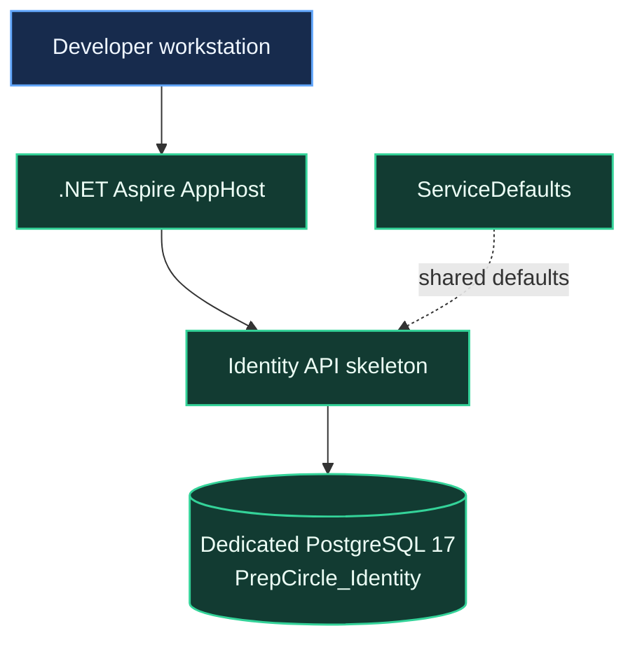
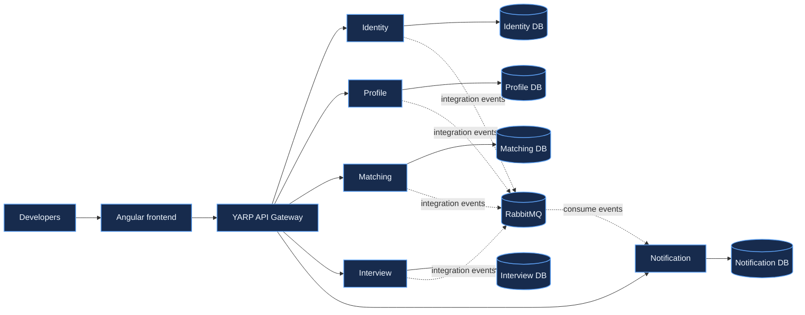

# PrepCircle — Architecture overview

> This document summarizes the selected architecture and the implementation status visible in the repository. It separates the existing foundation from planned components.

## 1. Product context

PrepCircle is a peer-to-peer interview preparation platform for developers. Its intended workflow is to help developers discover practice partners, schedule reciprocal interview sessions, take turns as interviewer and candidate, and exchange feedback.

## 2. Current implementation baseline

The repository currently contains the following foundation:

| Component | Current state |
|---|---|
| .NET solution | .NET 10 solution and shared build configuration |
| Aspire AppHost | Present; used for local application orchestration |
| ServiceDefaults | Present; shared health checks, OpenTelemetry, service discovery and HTTP resilience |
| Identity API | Skeleton registered with Aspire |
| PostgreSQL | Dedicated PostgreSQL 17 Compose setup for local development |
| Identity data access | EF Core 10 / Npgsql connection configured |
| Database health | PostgreSQL connectivity health check configured |

### Current local foundation

This is a local development foundation. The Identity API is a skeleton; it should not be interpreted as a completed or publicly available authentication service.

## 3. Selected target architecture

The following components are selected for later incremental implementation:

- Angular frontend, initially running separately from Aspire.
- YARP as the public API gateway.
- Identity service authentication using ASP.NET Core Identity and OpenIddict.
- Profile service for developer profiles, skills, experience and availability.
- Matching service for partner discovery and matching rules.
- Interview service for scheduling, interview lifecycle, role switching and feedback.
- Notification service for notifications and reminders.
- PostgreSQL Community Edition with a separate database owned by each business service.
- RabbitMQ for asynchronous integration events when a consuming service requires them.

### Target component map

All elements in this target map are planned unless listed in the current implementation baseline above. The diagram describes intended boundaries and communication patterns, not a deployed system.

## 4. Architecture principles

### Service ownership

Each business service owns its data and database. Other services should not directly query that database. Cross-service communication uses explicit APIs or asynchronous integration events.

### Communication

- REST is selected for synchronous communication.
- RabbitMQ is selected for asynchronous integration events.
- Do not introduce messaging before a real consuming service requires it.

### Identity and security

- Use established ASP.NET Core Identity and OpenIddict capabilities rather than implementing a custom authentication protocol.
- Keep credentials in local secret storage or environment files excluded from source control.
- Do not commit passwords, tokens, API keys or connection secrets.

### Reliability

As messaging is introduced, design for duplicate delivery and failure scenarios. The selected reliability practices include idempotent consumers, publisher confirms, consumer acknowledgements, retries, dead-letter queues, correlation IDs and the Transactional Outbox pattern where appropriate.

### Local development and cost

- Use .NET Aspire for local orchestration.
- Use dedicated local infrastructure for PrepCircle.
- Keep development and production choices within the project's zero-cost requirement.
- Do not modify databases, containers or resources belonging to other projects.

## 5. Delivery approach

Implementation proceeds in small, validated phases. The current baseline is the .NET/Aspire/Identity/PostgreSQL foundation. Authentication, migrations, the gateway, the remaining services, messaging and the frontend are future work.

No delivery dates are published. The project should not be described as production-ready until the relevant functionality, security, testing and operational work has been completed.

## 6. Source and status

This overview is based on the repository's current README and project guidance. For the current implementation and local development workflow, see the private PrepCircle repository documentation.
